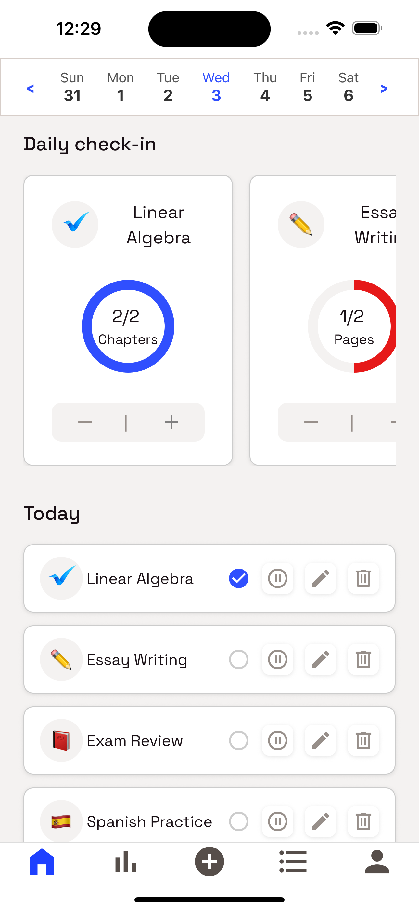
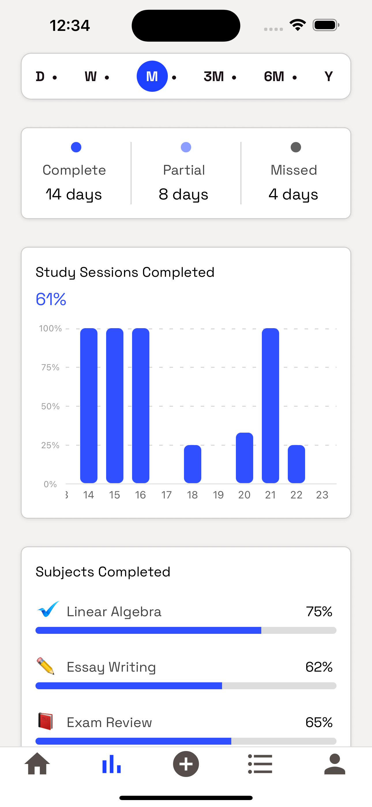
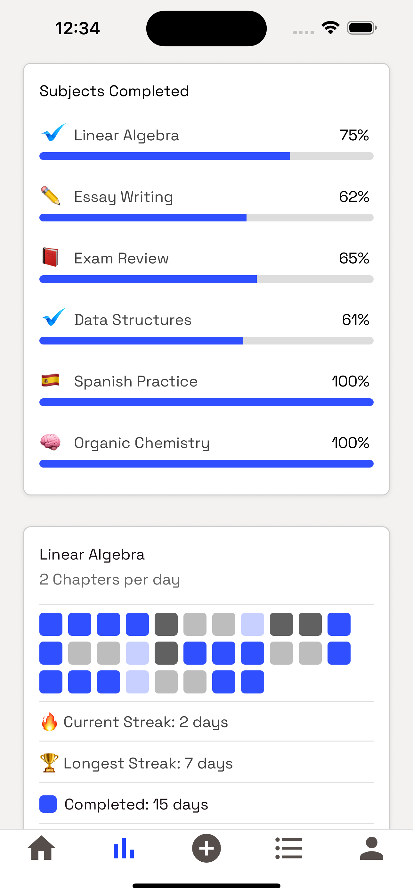
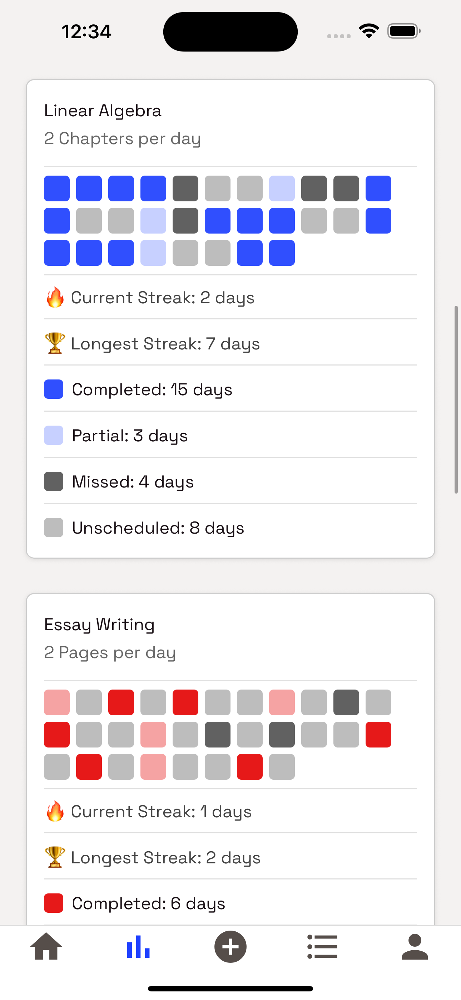
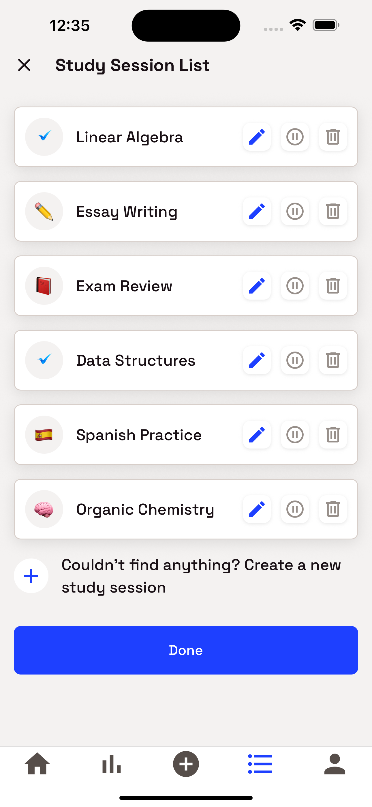

# Sorin Study

Sorin Study is a published iOS application for building study habits and tracking daily progress. Study data is stored on the device, so the app can be used without an account. Cloud synchronization is optional for people who want that data available across devices.

The app is available on the [Apple App Store](https://apps.apple.com/us/app/sorin-study/id6772776460).

## Screenshots

  
  
  

  
  

## Features

- Create and manage study habits.
- Track daily progress and maintain a study routine.
- Store data locally on the device with AsyncStorage.
- Receive local reminders through Expo Notifications.
- Create an account, sign in, and reset a password.
- Optionally sync data across devices with Supabase.
- Transfer existing guest data to a registered account.

## Technology Stack

- React Native
- Expo and EAS
- TypeScript
- MobX-State-Tree
- AsyncStorage
- Supabase

## Architecture

Sorin Study is local-first. Habit and progress data is stored on the device with AsyncStorage, and the app can be used without creating an account. Supabase authentication and cloud synchronization are optional. Someone who starts as a guest can later create an account and transfer that existing data to it.

The application is built with React Native and Expo. MobX-State-Tree manages application state.

## Project Information

- **Platform:** iOS
- **Application:** Sorin Study
- **Bundle ID:** `com.sorin.study`
- **App Store:** [Sorin Study on the App Store](https://apps.apple.com/us/app/sorin-study/id6772776460)

This repository is a portfolio overview of the published application. It describes the product, the architecture, and the technology used to build it. The application source code is private and is not included here.
